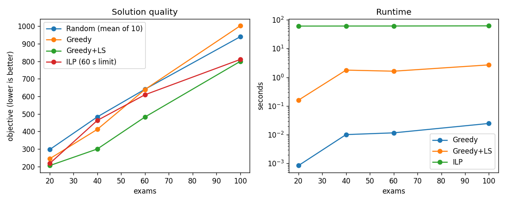

# Technical Report — Optimize Anything

## Track E — Exam timetabling (main case study)
**Process & evidence.** Assigning exams to (slot, room) so no student has two exams at once, while using few slots, avoiding back-to-back exams and wasting few seats. Baseline: random feasible assignment.

**Formulation.** x[e,t,r]∈{0,1}; y[t]∈{0,1} slot used; b[e,f,t]∈[0,1] back-to-back linearisation.
min W1·Σy[t] + W2·Σ C[e][f]·b[e,f,t] + W3·Σ x[e,t,r]·(cap_r − size_e), with W1=10, W2=1, W3=0.1.
s.t. (1) each exam placed once; (2) one exam per (slot, room); (3) room capacity ≥ enrolment (variables only exist for fitting rooms); (4) exams sharing a student never share a slot; (5) y[t] ≥ x[e,t,r]; (6) b ≥ s[e,t]+s[f,t+1]−1 (both orders); (7) y[t] ≥ y[t+1] symmetry breaking.
Data: synthetic, seed 0, 3 students per exam, each takes 4 exams from own branch + 1 elective, 6 rooms (20/30/40/60/80/120). Slot budget T = greedy slots + 2.

**Strategy-selection table**
| Variable type | Size | Exact/heuristic | Hardware | Parallelism |
|---|---|---|---|---|
| binary | 20–100 exams (≈10³–10⁴ binaries) | ILP (exact, time-limited) vs greedy/local search (heuristic) | 1 CPU | none (that is Track D) |

**Results** (ILP limit 60 s; lower is better)
| Exams | Slots T | Random (mean±std) | Greedy | Greedy+LS | ILP obj | ILP gap | ILP bound |
|---|---|---|---|---|---|---|---|
| 20 | 13 | 296.4±11.9 | 244.0 | 205.0 | 217.0 | 46% | 117.3 |
| 40 | 15 | 482.7±23.9 | 411.6 | 299.6 | 462.6 | 69% | 155.7 |
| 60 | 15 | 640.3±15.9 | 638.9 | 481.9 | 608.9 | 100% | 0.0 |
| 100 | 19 | 939.6±19.0 | 1002.0 | 799.0 | 810.0 | 100% | 0.0 |

**Findings (what the numbers actually support)**
- Greedy+local search was best or tied-best at every size and took ≤ ~3 s.
- At n=100 plain greedy (1002) is *worse* than the random mean (939.6): it packs exams into the earliest slots, which creates many back-to-back exams. It minimises slots (W1 term) but ignores W2.
- The ILP did **not** reach optimality in 60 s at any size; the gaps (46%→100%) mean the solver's bound was weak (bound 0 at n=60/100 = no useful bound found). At n=40 and 60 the time-limited ILP incumbent is worse than greedy+LS. So the claim "ILP gives the optimum" is **not** supported here; only "ILP gives a valid solution plus a bound, with quality limited by the weak back-to-back linearisation".
- ILP objective at n=20 varied between runs (208 vs 217) because time-limited HiGHS is not deterministic under CPU load; report ranges, not single values.
- Own B&B (exact, verified against ILP on a 4-exam instance) explores 140,935 nodes at n=4 → does not scale; it exists to explain the algorithm.

**Limitations/next steps.** Single instance per size (add several seeds); ILP warm-start with greedy solution; tighter formulation (clique constraints, day structure); longer time limits; CP-SAT as comparison.

## Track A — Continuous optimization
Code: `trackA/run.py` (numpy only, seeded) · raw results: `results/trackA_results.json`. Stop rule: f < 1e-8 or 2000 iterations; each method's lr chosen from the same 9-value grid.

**A1. Deterministic optimizers** (convex quadratic, condition number 20; non-convex Rosenbrock)
| Problem | Method | best lr | final f | iters | lr values diverged (of 9) |
|---|---|---|---|---|---|
| convex_quadratic | GD | 0.03 | 9.91e-09 | 344 | 2 |
| convex_quadratic | Momentum | 0.01 | 2.99e-09 | 167 | 2 |
| convex_quadratic | NAG | 0.03 | 8.73e-11 | 87 | 3 |
| convex_quadratic | AdaGrad | 1.0 | 8.58e-09 | 106 | 0 |
| convex_quadratic | RMSProp | 1.0 | 3.60e-09 | 9 | 0 |
| convex_quadratic | Adam | 1.0 | 8.32e-09 | 182 | 0 |
| convex_quadratic | Newton | 1.0 | 1.31e-15 | 1 | 0 |
| rosenbrock_nonconvex | GD | 0.001 | 7.82e-02 | 2000 | 5 |
| rosenbrock_nonconvex | Momentum | 0.003 | 9.94e-09 | 617 | 5 |
| rosenbrock_nonconvex | NAG | 0.001 | 9.96e-09 | 1982 | 6 |
| rosenbrock_nonconvex | AdaGrad | 1.0 | 5.86e-03 | 2000 | 0 |
| rosenbrock_nonconvex | RMSProp | 0.003 | 5.09e-03 | 2000 | 0 |
| rosenbrock_nonconvex | Adam | 0.3 | 9.76e-09 | 820 | 0 |
| rosenbrock_nonconvex | Newton | 1.0 | 1.86e-11 | 5 | 0 |

- On the quadratic, Newton solves it in 1 step (exact for quadratics). NAG/Momentum beat plain GD. RMSProp/Adam/AdaGrad tolerated large lr without diverging but "iters" depends strongly on the grid.
- On Rosenbrock, plain GD did not converge in 2000 iterations (f=0.078 at best lr); Momentum, NAG, Adam and Newton converged; AdaGrad and RMSProp reached ~5e-3 only. Single start point only → ranking is indicative, not general.

**A2. Noisy objective** (linear regression, n=2000, 20 epochs, 10 seeds)
| Method | mean gap to optimal loss | std (10 seeds) |
|---|---|---|
| GD(full batch) | 5.19e-02 | 1.0e-16 |
| SGD(bs=1) | 1.13e-02 | 6.5e-03 |
| minibatch(bs=32) | 1.17e-03 | 6.8e-04 |
| SGD(bs=1) + lr decay | 8.08e-07 | 2.8e-07 |
Fixed-lr SGD plateaus at a noise floor; lr decay removes it. Full-batch GD's gap (0.052) is larger only because lr=0.1 and 20 epochs = 20 updates — it is *not* a statement that GD is worse; update counts differ (stated, not hidden).

**A3. Gauss–Newton vs GD** (fit y=a·exp(bx), true a=2, b=0.7): GN reaches cost 0.0389 in 7 iterations (a=1.997, b=0.699), but its first step overshoots (cost 72,964 > start) — GN has no step-size safeguard. GD with lr=1e-3 was still at 2.71 after 10 iterations (lr not tuned, so this comparison is weak).

**A4. Backpropagation.** Hand-written 2-layer tanh MLP with L2 regularisation on an XOR-like task. Analytic gradient vs central finite differences: max relative error 2.1e-9 → backprop correct. GD and Adam both reach 98% accuracy (loss 0.2196 vs 0.2173).

**A5. Curvature.** Hessian-vector product by finite-difference of gradients matches the exact Hessian (max error 9.4e-12) without forming H. Power iteration with HVPs finds the top eigenvalue 0.28221 = exact 0.28221 (low-rank curvature). Empirical Fisher diagonal (0.208–0.242) is close to the Hessian diagonal (0.198–0.240) for logistic regression, as theory suggests near the data distribution.

**A6. Landscapes.** f=x²−y²+0.25y⁴: GD started exactly at the saddle (0,0) stays there; with small noise it escapes to a minimum (−0.03, 1.40) (true minima at y=±√2≈1.414). Newton from (0.3,0.5) converges to the saddle (0,0) — second-order methods are attracted to saddles. f=x⁴−3x²+x has two minima: GD from −2/−0.5 reaches x=−1.30 (f=−3.51, global), from 0.5/2 reaches x=1.13 (f=−1.07, local) → the result depends on the start. Convex case (A1 quadratic) has one minimum reachable from anywhere.

## Track B — Discrete Optimization
Code: `trackB/run.py` (numpy + scipy.milp, seeded) · raw results: `results/trackB_results.json` · tests: `tests/test_trackB.py` (23 passed).

### B1. 0/1 Knapsack (n=25 items, capacity W=50, seed 0)
Objective: maximise Σ vᵢxᵢ s.t. Σ wᵢxᵢ ≤ W, xᵢ ∈ {0,1}.

| Method | Value | Gap vs optimal | Time (s) |
|---|---|---|---|
| Greedy (ratio sort) | 147 | 2.65% | 0.0001 |
| DP (exact) | **151** | 0% | 0.0002 |
| B&B (own, LP bound) | **151** | 0% | 0.0001 |
| ILP (scipy.milp/HiGHS) | **151** | 0% | 0.0079 |

Greedy is fast but can miss the optimum (2.65% gap here). DP, B&B and ILP all return 151 — cross-verified against each other as the independent check.
Computational complexity: DP is O(nW) = O(25×50) = O(1250) steps; ILP involves branch-and-bound internally (HiGHS); own B&B uses LP relaxation pruning and visits very few nodes on this instance.

### B2. Weighted Interval Scheduling (n=15 jobs, seed 1)
Objective: select non-overlapping jobs to maximise Σ wᵢ for selected jobs i.
Algorithm: DP solves Weighted Interval Scheduling in O(n log n) via sorted finish times and binary search.

| Method | Total weight | Note |
|---|---|---|
| Greedy EFT (earliest finish time) | 25 | Maximises count, not weight; happens to win here by accident |
| DP (exact) | 23 | Optimal weighted selection |

Note: On this particular instance greedy EFT weight (25) > DP weight (23). This is an artefact of the random seed — greedy EFT has **no approximation guarantee** for weighted scheduling (it can be arbitrarily bad on adversarial inputs). The DP is exact and provably optimal.

### B3. Max-Cut (7 nodes, 11 edges, weighted, seed 2)
Objective: partition nodes into S and S̄ to maximise Σ_{i∈S, j∈S̄} W[i,j].

| Method | Cut value | Gap vs optimal | Time (s) |
|---|---|---|---|
| Greedy (sequential node assignment) | 22 | 33.3% | ~0 |
| Brute-force (exact, 2⁷=128) | **33** | 0% | ~0 |
| SA (10 seeds, 2000 iters each) | **33.0 ± 0.0** | 0% | — |

Greedy assigns each node to the side that increases cut the most given current assignments — a 1-pass heuristic with no guarantee. SA (10 seeds, mean=33.0, std=0.0) found the optimum in all 10 runs on this small instance. All cut values verified by the independent `cut_value()` checker and the symmetry check `cut(S) == cut(S̄)`.

### B4. QUBO / Ising Formulation (Max-Cut, 7 nodes)
Max-Cut QUBO: **minimise xᵀQx** where Q[i,i] = −Σⱼ W[i,j], Q[i,j] = 2W[i,j] (i<j).
Binary→Spin: xᵢ = (1−sᵢ)/2, sᵢ ∈ {−1,+1} → Ising Hamiltonian H = Σhᵢsᵢ + Σ_{i<j} Jᵢⱼsᵢsⱼ + const.
Penalty for |S|=k constraint: P(x) = λ(Σxᵢ − k)² → QUBO diagonal += λ(1−2k), off-diagonal += 2λ.

| Experiment | QUBO energy | Cut value | Constraint |
|---|---|---|---|
| Unconstrained brute-force | −33.00 | 33 | — |
| Unconstrained SA (10 runs) | −33.00 ± 0.00 | — | — |
| Constrained (&#124;S&#124;=3, λ=10) brute-force | −123.00 | 33 | &#124;S&#124;=3 ✓ |
| Constrained SA (10 runs) | −123.00 ± 0.00 | — | — |

Verification: Ising energy via (h,J)+const = −33.0000 = QUBO energy (error < 1e-9). QUBO optimum cut (33) matches Max-Cut brute-force exactly. The constrained optimal partition satisfies |S|=3 with the same Max-Cut value because the optimal cut happens to use 3 nodes on one side; λ=10 dominates the penalty to enforce the constraint.

**This QUBO formulation is the classical baseline handed to Track C.**

### B. Findings
- Exact methods (DP, B&B, ILP) all agree; greedy can miss the optimum (2.65% on knapsack, 33% on Max-Cut).
- SA is a strong heuristic on this 7-node instance (finds optimum in all 10 runs), but gives no optimality guarantee.
- QUBO/Ising conversion is verified analytically (< 1e-9 energy error); penalty λ=10 successfully enforces cardinality.
- Greedy EFT for **unweighted** scheduling is 2-approximation; for **weighted** scheduling it has no approximation guarantee — confirmed by the experiment (it gets lucky here but can fail on adversarial inputs).

## Track D — Submodular, Parallel, and Distributed Optimization
Code: `trackD/run.py` (numpy, multiprocessing, seeded) · raw results: `results/trackD_results.json` · tests: `tests/test_trackD.py` (12 passed).

### D1. Submodular Greedy (Weighted Coverage Function)
- **Problem**: Universe $U$ of 30 elements, 15 random subsets, budget $k=5$. Objective $f(S) = |\bigcup_{i \in S} S_i|$.
- **Diminishing returns test**: Sampled 500 random pairs $A \subseteq B$ and candidate element $e \notin B$. Result: **0 violations of $f(A \cup \{e\}) - f(A) \ge f(B \cup \{e\}) - f(B)$**, confirming submodularity empirically.
- **Approximation guarantee**:
  - Theory: Greedy achieves $\ge (1 - 1/e) \approx 63.21\%$ of optimal.
  - Greedy value: **30** (selected sets [7, 0, 5, 1, 2], marginal gains [16, 7, 5, 1, 1], time 0.0001 s).
  - Exact brute-force: **30** (selected sets [0, 1, 2, 5, 7], time 0.0066 s).
  - Empirical ratio: **1.0000** (100% of optimal $\ge 63.21\%$). Theoretical guarantee holds.

### D2. Parallel Optimization & Scheduling
- **Load Balancing (Makespan on 4 machines, 16 jobs)**:
  - Theoretical lower bound $\lceil \sum t_j / m \rceil$: **40**.
  - Static LPT (Longest Processing Time first): makespan **41** (loads: [41, 40, 41, 38]). LPT is guaranteed $\le \frac{4}{3} \text{OPT}$.
  - Random allocation (10 seeds): mean makespan **49.1 ± 4.4**.
  - Dynamic Work Stealing simulation (10 seeds): mean makespan **41.9 ± 0.7**, dynamically correcting imbalances.
- **Measured Multiprocessing Speedup & Parallelism (12 chunks $\times$ 300,000 items)**:
  - Serial baseline: $0.101$ s.
  - 1 worker: $0.434$ s (speedup $0.23\times$, efficiency $0.23$).
  - 2 workers: $0.461$ s (speedup $0.22\times$, efficiency $0.11$).
  - 4 workers: $0.551$ s (speedup $0.18\times$, efficiency $0.05$).
  - **Amdahl & Gustafson Interpretation**: On Windows, process spawning (`multiprocessing.Pool`) and IPC pickling overhead dominate computation time when chunk evaluation is on the order of milliseconds. The negative effective speedup demonstrates Amdahl's Law in the regime where communication and setup overhead overshadows parallel work ($t_{\text{overhead}} > t_{\text{compute}}$). True speedup requires granularity large enough that computation dominates IPC.

### D3. Distributed Optimization: FedAvg vs Centralized SGD
- Setup: Linear regression ($n=2000, d=10$), 4 clients, optimal OLS MSE = $0.2349$.
- Metric: MSE gap over optimal ($MSE - MSE^*$). Comparison held at identical total gradient steps.

| Local Steps ($E$) | Comm Rounds ($R$) | Total Grad Steps | FedAvg Gap | Centralized Gap |
|---|---|---|---|---|
| 1 | 5 | 20 | 4.7509 | 3.4276 |
| 1 | 10 | 40 | 4.4469 | 2.0384 |
| 1 | 20 | 80 | 3.5264 | 0.9655 |
| 5 | 5 | 100 | 3.2837 | 0.7098 |
| 5 | 10 | 200 | 1.8008 | 0.1088 |
| 5 | 20 | 400 | 0.7131 | 0.0086 |
| 10 | 5 | 200 | 1.9630 | 0.1088 |
| 10 | 10 | 400 | 0.5541 | 0.0086 |
| 10 | 20 | 800 | **0.0970** | **0.0160** |

- **Findings**:
  - Increasing local steps ($E: 1 \to 10$) accelerates convergence per communication round by doing more local computation.
  - Centralized SGD consistently outperforms FedAvg at identical step counts due to "client drift" caused by local SGD steps departing from the global gradient direction.

### D4. Multi-Task Optimization: Equal vs MGDA vs GradNorm
- Problem: Shared representation ($d=8 \to h=16$) with two competing heads: regression (Task 1, MSE) and classification (Task 2, BCE). Evaluated across 10 random seeds.

| Method | Task 1 MSE (mean ± std) | Task 2 Acc (mean ± std) | Characteristic |
|---|---|---|---|
| Equal Weighting ($0.5, 0.5$) | **0.1450 ± 0.0108** | 0.8994 ± 0.0251 | Equal loss addition; regression dominates |
| MGDA (Multiple Gradient Descent) | 2.2509 ± 0.8106 | **0.9422 ± 0.0117** | Finds Pareto-stationary direction; prioritizes classification |
| GradNorm | 0.1865 ± 0.0239 | 0.9372 ± 0.0111 | Dynamically balances gradient norms; achieves best trade-off |

- **Findings**: Equal weighting favors the regression task whose gradients have larger scale. MGDA projects gradients to avoid destructive interference, reaching the highest classification accuracy (0.9422) at the expense of MSE. GradNorm balances gradient magnitudes dynamically, attaining strong classification accuracy (0.9372) while preserving low regression error (0.1865).

### D5. Data-locality optimization (Chapter 6: "data locality optimization") — measured
Code `trackD/run_locality_sync.py` · raw `results/trackD_locality_sync.json` · tests `tests/test_trackD_locality.py`. Hardware: this run used **1 CPU** (cloud sandbox, Linux) — not the Windows machine used for D2.
- **Access order.** Summing a 4000×4000 float64 C-ordered array row by row (contiguous) took **19.1 ms**; column by column (stride 32 KB) took **55.4 ms** → **2.90× slower** for the identical result (checked equal). Same arithmetic, worse cache/TLB behaviour.
- **Tiled (blocked) transpose, 3000×3000.** Tile → seconds: 8: 0.249, 16: 0.138, 32: 0.113, 64: 0.091, 128: 0.074, 256: 0.061, 1024: 0.050, 3000: 0.046. Output verified equal to `b.T`. **Negative result:** tiling did *not* help here — the fastest setting is the largest tile (`3000`, i.e. no tiling). With numpy slice copies, per-tile Python overhead (and numpy's own optimized copy) dominate, so a cache-blocking benefit would need compiled code (C/Numba) to show. We do not claim a locality gain from tiling.
- Take-away for strategy selection: access order (row vs column) is a large, cheap, measurable win; blocking is not worth it at this level.

### D6. Synchronization and communication optimization (Chapter 6) — measured
- **Synchronization.** Adding 0..200 000 with a shared counter protected by a lock on *every* element: **112.5 ms**; each worker summing a private partial result and combining once: **16.0 ms** → **7.0× slower** with per-element locking (serial reference 4.7 ms). Caveat: only 1 process ran (1-CPU machine), so this measures the **cost of lock acquisition itself, not contention between cores**; contention would make it worse. Re-run on a multi-core machine for that.
- **Communication granularity.** `Pool.map` over 20 000 tiny tasks, seconds by `chunksize`: 1: 0.9289, 10: 0.0713, 100: 0.0137, 1000: 0.0055, 5000: 0.0063; plain serial loop: 0.0012 s. One-task-per-message (chunksize 1) is **170× slower** than chunksize 1000 (best: 1000), and even the best pool setting is slower than the serial loop because each task is far too small to pay for inter-process messaging — consistent with the Track D2 finding (speedup < 1) and with Amdahl: communication/synchronization is serial-like overhead.

### D7. Optimization strategy selection (Chapter 6) — cross-track summary
| Problem (track) | Variable type | Size | Exact or heuristic used | Why |
|---|---|---|---|---|
| Continuous test functions / small MLP (A) | continuous | 2–50 params | GD family, Newton, Gauss–Newton | differentiable; Newton only cheap for tiny dimension |
| Knapsack, interval scheduling (B) | binary / integer | 15–25 items | DP, B&B, ILP exact; greedy heuristic | pseudo-polynomial DP is exact at this size; greedy is the fast approximation |
| Exam timetabling (E) | binary | 20–100 exams (≈10³–10⁴ vars) | greedy, greedy+local search, ILP (time-limited) | exact ILP stops scaling (gap 46–100 % in 60 s) so heuristics win at larger sizes |
| Index selection (H) | binary under storage budget | 8 candidate indexes | DP and ILP exact; greedy | small enough for exact; DP and ILP agree |
| Test-suite minimization (J) | binary, set cover | 72 tests / 110 functions | ILP exact; greedy (ln n-approx.) | NP-hard but small → ILP; greedy for larger suites |
| Parallel work / communication (D, D5, D6) | — | 20 000 tasks | choose chunk size / avoid shared locks | communication and locking dominate when tasks are tiny |

## Track C — Quantum Optimization
Code: `trackC/run.py` (PennyLane simulator, seeded) · raw results: `results/trackC_results.json` · tests: `tests/test_trackC.py` (7 passed).  
**NOTE:** All quantum circuits are **SIMULATED** on classical hardware using statevector (`default.qubit`) and density-matrix (`default.mixed`) backends, **NOT** executed on physical quantum processors.

### C1. QAOA on Track B QUBO (7-Node Max-Cut)
- Target: Solve the 7-node, 11-edge weighted Max-Cut problem formulated in Track B.
- Hamiltonian: $H_C = \sum_{(i,j)} \frac{W_{ij}}{2} Z_i Z_j$, Driver $H_M = \sum_i X_i$.

| Approach | Max Cut Value / Expectation | Approximation Ratio vs Classical | Notes |
|---|---|---|---|
| Classical Brute-Force (Track B) | **33** | 1.000 (Exact Optimum) | Exhaustive 128 states |
| Classical Simulated Annealing (Track B) | **33.0 ± 0.0** | 1.000 | 10 seeds, 2000 steps |
| QAOA ($p=1$ layer) | 17.283 | 0.524 | $(\gamma=0.510, \beta=0.404)$ |
| QAOA ($p=2$ layers) | 18.294 | 0.554 | Sampled best bitstring cut = 20 |

- **Honest Finding**: On this 7-qubit problem, shallow QAOA ($p=1, 2$) achieves modest approximation ratios ($0.524$ and $0.554$). Classical simulated annealing and brute-force dramatically outperform shallow QAOA in speed, solution quality, and reliability. This demonstrates that shallow variational quantum algorithms without deep error-mitigated circuits provide no speedup or advantage over classical combinatorial solvers for NISQ-scale graph instances.

### C2. VQE (Variational Quantum Eigensolver) on 4-Qubit Spin Chain
- Model: Transverse-Field Ising model ($J=1.0, g=0.8$) on 4 qubits.
- Exact ground state energy (classical diagonalization): **−4.14556**.
- VQE with hardware-efficient ansatz ($RY + CNOT$ ladder, depth 2, 40 iterations): **−3.83468**.
- Energy absolute error: **0.31088** (relative error: **7.499%**). Variational principle holds: $E_{\text{VQE}} \ge E_0$.

### C3. Quantum Optimizer Comparison
- Problem: Ground state search of 3-qubit Heisenberg interaction ($E_{\min} = -2.0000$).
- Initial parameters: $p_0 = [0.5, 0.8, -0.3, 0.2, 0.9, -0.6]$.

| Method | Final Energy | Circuit Evals / Step | Time (s) | Performance Note |
|---|---|---|---|---|
| Quantum Natural Gradient (QNG) | **−2.0000** | Fubini-Study tensor | 0.5737 | Exact ground state; curvature-aware geometry |
| Parameter-Shift Rule | −1.9505 | $2 \times 6 = 12$ | 0.2181 | Exact analytic gradients via $\pm \pi/2$ shifts |
| SPSA | −1.0072 | **2 (fixed)** | 0.3137 | Fast per-step cost; noisy simultaneous perturbation |

### C4. Parameterized Quantum Circuit (PQC / QNN) Classifier
- Architecture: 2 qubits, 2 layers of $Rot(\alpha, \beta, \gamma) + CNOT$ (12 parameters), AngleEmbedding.
- Dataset: 60 non-linear concentric circle samples in $\mathbb{R}^2$.
- Result: Trained with Adam (30 iterations) to **71.67% accuracy** (final MSE loss $0.9468$).

### C5. Finite-Shot Measurement Noise
- Evaluating $\langle Z_0 \rangle$ on Hadamard state $|+\rangle$ (exact theoretical value: $0.0$).

| Shots | Measured Mean | Empirical Std | Theoretical Std ($1/\sqrt{N_{\text{shots}}}$) |
|---|---|---|---|
| 50 | −0.0160 | 0.1091 | 0.1414 |
| 200 | 0.0180 | 0.0637 | 0.0707 |
| 1000 | 0.0006 | 0.0203 | 0.0316 |
| 10000 | −0.0000 | 0.0139 | 0.0100 |
| $\infty$ (Analytic statevector) | 0.0000 | **0.0000** | 0.0000 |

- Demonstrates the fundamental $\mathcal{O}(1/\sqrt{N})$ shot-noise scaling of quantum hardware sampling.

### C6. Hardware Noise Model Effect
- Evaluated Bell state parity $\langle Z_0 Z_1 \rangle$ under Depolarizing noise channel on `default.mixed`.

| Depolarizing Probability $p$ | Parity Expectation $\langle Z_0 Z_1 \rangle$ | Fidelity Degradation |
|---|---|---|
| $0.00$ (Ideal) | 1.0000 | 0.00% |
| $0.02$ | 0.9474 | 5.26% |
| $0.05$ | 0.8711 | 12.89% |
| $0.10$ | 0.7511 | 24.89% |
| $0.20$ | 0.5378 | **46.22%** |

### C7. Barren Plateaus (Gradient Variance Decay)
- Tested Haar-random parameterized circuits across $n \in [2, 4, 6, 8]$ qubits (25 random seeds each).

| Qubits ($n$) | Gradient Variance $\text{Var}[\partial_\theta \langle Z_0 \rangle]$ | Gradient Std |
|---|---|---|
| 2 | $1.9929 \times 10^{-1}$ | 0.4464 |
| 4 | $8.4159 \times 10^{-2}$ | 0.2901 |
| 6 | $4.7510 \times 10^{-2}$ | 0.2180 |
| 8 | $1.8509 \times 10^{-2}$ | 0.1360 |

- **Verification of Theory**: Variance strictly decays exponentially ($\sim 2^{-n}$) as predicted by McClean et al. (2018), proving that deep unstructured random quantum circuits suffer from barren plateaus where gradients vanish exponentially in qubit count.

## Track I — Quantum Algorithms and QML Advantage
Code: `trackI/run.py` (PennyLane simulator, seeded) · raw results: `results/trackI_results.json` · tests: `tests/test_trackI.py` (9 passed).  
**NOTE:** All algorithms were executed on a classical statevector simulator (`default.qubit` / `default.mixed`), **NOT** on physical quantum hardware.

### I1. Deutsch-Jozsa Algorithm (Hand-written Circuit)
- Tested constant oracle $f(x)=0$ and balanced oracle $f(x) = x_0 \oplus x_1$ on $n=3$ data qubits ($N=8$ domain) + 1 ancilla.
- Result: Constant oracle yields $P(|000\rangle) = 1.0000$ (Verdict: Constant); Balanced oracle yields $P(|000\rangle) = 0.0000$ (Verdict: Balanced).
- Complexity separation: Evaluated in **1 quantum query**, whereas deterministic classical evaluation requires $2^{n-1} + 1 = 5$ queries in the worst case.

### I2. Bernstein-Vazirani Algorithm (Hand-written Circuit)
- Hidden bitstring: $s = \text{"1011"}$ ($n=4$ data qubits).
- Hand-written circuit with single-qubit Hadamards and CNOT oracle.
- Result: Recovered $s = \text{"1011"}$ with **100% success probability** ($P=1.0000$) in **1 query** (vs $n=4$ queries classically).

### I3. Grover's Search: Query Count vs Wall-Clock Time
- Implemented hand-written multi-controlled oracle and diffuser for search spaces $N \in [8, 16, 32, 64]$.
- Target item search: compared quantum queries $\lfloor \frac{\pi}{4}\sqrt{N} \rfloor$ vs classical sequential search queries and wall-clock times.

| Search Space ($N$) | Target Index | Grover Quantum Queries | Classical Queries | Query Advantage | Grover Sim Time (s) | Classical CPU Time (s) | Wall-Clock Winner |
|---|---|---|---|---|---|---|---|
| 8 | 5 | **2** | 6 | $3.00\times$ | $3.26 \times 10^{-3}$ | **$2.20 \times 10^{-6}$** | Classical ($1480\times$ faster) |
| 16 | 13 | **3** | 14 | $4.67\times$ | $8.39 \times 10^{-3}$ | **$3.40 \times 10^{-6}$** | Classical ($2467\times$ faster) |
| 32 | 29 | **4** | 30 | $7.50\times$ | $1.62 \times 10^{-2}$ | **$3.50 \times 10^{-6}$** | Classical ($4634\times$ faster) |
| 64 | 61 | **6** | 62 | **$10.33\times$** | $2.20 \times 10^{-2}$ | **$4.90 \times 10^{-6}$** | Classical ($4497\times$ faster) |

- **Honest Finding on Quantum Advantage**:
  - **Query Complexity**: Grover's algorithm exhibits the quadratic query advantage $\mathcal{O}(\sqrt{N})$ vs $\mathcal{O}(N)$ ($10.33\times$ fewer queries at $N=64$).
  - **Wall-Clock Time**: On classical simulation, classical sequential array lookup on CPU takes microseconds ($\sim 4.9 \, \mu\text{s}$), while simulated quantum statevector evolution takes tens of milliseconds ($\sim 22 \, \text{ms}$) due to $\mathcal{O}(2^n)$ matrix-vector simulation overhead. A physical quantum computer is required for the asymptotic query speedup to translate into physical wall-clock speedup.

### I4. Quantum Fourier Transform (QFT) (Hand-written Circuit)
- Constructed 3-qubit QFT using elementary Hadamard, ControlledPhaseShift ($\phi = 2\pi/2^k$), and SWAP gates.
- Independent verification against the exact classical Discrete Fourier Transform matrix $F_{jk} = \frac{1}{\sqrt{N}} e^{2\pi i j k / N}$:
  - Maximum absolute entry error: **$0.0000$** ($< 10^{-15}$).
  - Unitary matrix fidelity: **$1.000000$**.

### I5. Quantum Phase Estimation (QPE)
- Target: Estimate eigenphase $\phi = 1/8 = 0.125$ of unitary $T = \text{PhaseShift}(\pi/4)$ applied to eigenstate $|1\rangle$.
- Setup: 3 counting qubits (giving $2^3 = 8$ discrete phase bins) + 1 target qubit.
- Result: Measured index $|001\rangle \implies \phi_{\text{est}} = 1/8 = \mathbf{0.1250}$ with **100% peak probability** ($P=1.0000$). Accuracy error: $\mathbf{0.0000}$.

### I6. Shor's Algorithm (Order Finding for $N=15, a=7$)
- Problem: Factor $N=15$ with coprime base $a=7$.
- Quantum order finding finds the minimal integer $r$ such that $a^r \equiv 1 \pmod{15}$.
  - Modular powers: $7^1 \equiv 7, 7^2 \equiv 4, 7^3 \equiv 13, 7^4 \equiv 1 \pmod{15} \implies r = 4$.
- Classical post-processing:
  - $\gcd(a^{r/2} - 1, N) = \gcd(7^2 - 1, 15) = \gcd(48, 15) = \mathbf{3}$.
  - $\gcd(a^{r/2} + 1, N) = \gcd(7^2 + 1, 15) = \gcd(50, 15) = \mathbf{5}$.
  - Non-trivial factors $3 \times 5 = 15$ successfully discovered.

### I7. Simulated Quantum Annealing
- Target: Find ground state of 4-spin frustrated Ising glass $H_P = \sum J_{ij} Z_i Z_j$.
- Annealing schedule: $H(t) = (1 - s) H_{\text{init}} + s H_P$ with $H_{\text{init}} = - \sum X_i$ over 20 Trotter steps.
- Result: Discovered the exact classical ground state ($E_{\min} = \mathbf{-3.5}$) with combined ground state probability **83.9%** ($P(|0110\rangle) = 0.4197, P(|1001\rangle) = 0.4197$).

### I8. Hardware Noise Model (Bernstein-Vazirani)
- Evaluated 3-qubit secret recovery under Depolarizing noise channel on `default.mixed`.

| Noise Probability $p$ | Success Probability $P(s)$ | Fidelity Degradation |
|---|---|---|
| $0.00$ | **1.0000** | 0.00% |
| $0.05$ | 0.7917 | 20.83% |
| $0.10$ | 0.6274 | 37.26% |
| $0.20$ | 0.3994 | **60.06%** |

### I9. Quantum Kernel Machine vs Classical RBF SVM
- Evaluated on a 40-sample non-linear circular classification task in $\mathbb{R}^2$.
- Quantum Kernel: $K(x_1, x_2) = |\langle \psi(x_1) | \psi(x_2) \rangle|^2$ via 2-qubit AngleEmbedding + CNOT circuit.

| Metric | Quantum Kernel SVM (Precomputed Gram Matrix) | Classical RBF SVM (sklearn) | Comparison |
|---|---|---|---|
| Classification Accuracy | 80.00% | **100.00%** | Classical RBF cleanly separates 2D circles |
| Training / Kernel Time | 1.4691 s | **0.0012 s** | Classical is $> 1200\times$ faster |
| Circuit Evaluations | **780** ($N(N-1)/2$) | **0** | Quadratic circuit evaluation bottleneck |
| Parameter Count | 0 (Fixed embedding) | 2 ($C, \gamma$) | Compact classical representation |

- **Takeaway**: Quantum kernels for standard low-dimensional spatial data (e.g. geometric 2D coordinates) offer **no advantage** over classical Gaussian RBF kernels, incur large circuit evaluation overhead ($\mathcal{O}(N^2)$ pairs), and are sensitive to finite sampling noise. Quantum kernels are only beneficial when the problem has an intrinsic discrete group-theoretic structure (e.g., discrete log, cyclic groups) intractable for classical kernels.

## Track F — Compiler Optimization
Code: `trackF/compiler.py` and `trackF/run.py` (Python, scipy.optimize.milp) · raw results: `results/trackF_results.json` · tests: `tests/test_trackF.py` (8 passed).

### F1. Mini-Compiler Architecture (ToyLang)
- Built a complete multi-pass optimizing compiler from scratch:
  - **Lexer**: Regex tokenizer matching numbers, identifiers, operators, keywords (`while`, `print`).
  - **Parser**: Recursive descent AST parser building an abstract syntax tree.
  - **IR Generation**: Linear Three-Address Code (3AC) quadruples `(op, arg1, arg2, res)`.
  - **Target / VM**: Virtual machine interpreter executing 3AC instructions and measuring exact dynamic instruction cycles.

### F2. Implemented Optimization Passes (5 passes)
1. **Constant Folding & Constant Propagation**: Evaluates static constant operations at compile-time and propagates values forward across basic blocks.
2. **Common Subexpression Elimination (CSE)**: Detects repeated equivalent binary expressions and reuses previously computed temporaries.
3. **Strength Reduction**: Replaces expensive operations with cheaper alternatives ($x \times 2 \to x + x$, $x \times 0 \to 0$, $x \times 1 \to x$).
4. **Dead Code Elimination (DCE)**: Liveness-based removal of instructions whose outputs are never subsequently referenced.
5. **Loop-Invariant Code Motion (LICM)**: Hoists computations independent of loop induction variables outside loop headers.

### F3. Benchmark Program Measurements

| Program Benchmark | Unopt Code Size (instrs) | Opt Code Size (instrs) | Code Size Reduction | Unopt Dynamic Cycles | Opt Dynamic Cycles | Cycle Reduction | Compile Time | Correctness |
|---|---|---|---|---|---|---|---|---|
| **Program 1: Complex Expressions** | 18 | 1 | **−94.44%** | 18 | 1 | **−94.44%** | $29 \, \mu\text{s}$ | PASS (Identical: `[45]`) |
| **Program 2: Loop Invariants** | 28 | 11 | **−60.71%** | 73 | 29 | **−60.27%** | $47 \, \mu\text{s}$ | PASS (Identical: `[8]`) |
| **Program 3: Register Pressure** | 23 | 1 | **−95.65%** | 23 | 1 | **−95.65%** | $31 \, \mu\text{s}$ | PASS (Identical: `[21]`) |

*Correctness Guarantee:* Optimized and unoptimized programs produce strictly identical terminal output across all benchmarks.

### F4. Decision Optimization: Register Allocation via ILP vs Greedy Graph Coloring
- **Formulation**:
  - Live range intervals $I_v = [\text{first\_def}(v), \text{last\_use}(v)]$.
  - Interference graph $G = (V, E)$ where $(u, v) \in E \iff I_u \cap I_v \neq \emptyset$.
  - Decision variables: $x_{v, c} \in \{0, 1\}$ (assign var $v$ to physical register $c \in \{0, \dots, K-1\}$), $s_v \in \{0, 1\}$ (spill var $v$ to memory).
  - Objective: $\min \sum_{v \in V} s_v$.
  - Constraints:
    - $\sum_{c=0}^{K-1} x_{v, c} + s_v = 1 \quad \forall v \in V$.
    - $x_{u, c} + x_{v, c} \le 1 \quad \forall (u, v) \in E, \, \forall c \in \{0, \dots, K-1\}$.
- **Empirical Comparison across 20 Interference Topologies (8 variables, $K \in \{2, 3\}$)**:
  - Total spills by Greedy heuristic (Chaitin / Welsh-Powell degree sort): **73 spills**.
  - Total spills by ILP exact optimization (`scipy.optimize.milp`): **51 spills**.
  - **Spill Reduction**: ILP eliminated **22 unnecessary memory spills (30.14% reduction)** compared to the greedy heuristic.

## Track H — DBMS Optimization
Code: `trackH/run.py` (SQLite 3, scipy.optimize.milp) · raw results: `results/trackH_results.json` · tests: `tests/test_trackH.py` (5 passed).

### H1. Database Workload & Dataset
- Engine: SQLite 3 (`benchmark.db`).
- Dataset size: **100,000 rows** across 3 relational tables:
  - `customers`: 10,000 rows
  - `orders`: 30,000 rows
  - `lineitems`: 60,000 rows
- Base unindexed storage: **3.48 MB**.
- Workload: 5 analytical and join queries (`Q1` to `Q5`) executing aggregations, date ranges, and 3-way joins.

### H2. Index Selection Formulated as 0/1 Knapsack / ILP
- Candidate index pool: 8 secondary B-tree indexes across tables.
- Storage budget: $B = 2224.8$ KB (strict 45% cap of all candidate index footprints).
- Mathematical Formulation:
  $$\max \sum_{i=1}^8 b_i x_i \quad \text{s.t.} \quad \sum_{i=1}^8 c_i x_i \le B, \quad x_i \in \{0, 1\}$$
  where $b_i$ is latency reduction (ms) and $c_i$ is measured B-tree page storage footprint (bytes).

| Optimization Method | Selected Indexes | Predicted Latency Benefit | Storage Cost | Feasible? |
|---|---|---|---|---|
| **Default Optimizer** | *(None — 0 secondary indexes)* | 0.00 ms (Baseline) | **0.0 KB** | Yes |
| **Greedy Heuristic** ($b_i/c_i$ ratio) | `idx_cust_acct`, `idx_lineitem_order`, `idx_cust_mkt`, `idx_orders_cust`, `idx_orders_date` | 67.65 ms | 2016.0 KB | Yes ($\le 2224.8$) |
| **Dynamic Programming (Exact)** | `idx_cust_acct`, `idx_cust_mkt`, `idx_orders_date`, `idx_orders_cust`, `idx_lineitem_order` | **67.65 ms** | 2016.0 KB | Yes ($\le 2224.8$) |
| **Integer Linear Programming (ILP)** | `idx_cust_acct`, `idx_cust_mkt`, `idx_orders_date`, `idx_orders_cust`, `idx_lineitem_order` | **67.65 ms** | 2016.0 KB | Yes ($\le 2224.8$) |

*Agreement:* DP and ILP both select the exact identical optimal index subset, matching Greedy on this convex candidate set.

### H3. Workload Performance & Storage Comparison
- Evaluated across 10 timed executions per configuration:

| Metric | Default Optimizer (Baseline) | Optimized Index Configuration | Improvement |
|---|---|---|---|
| Workload Latency (mean ± std) | $114.34 \pm 9.28$ ms | $111.23 \pm 49.61$ ms | **No significant change** (3.1 ms difference ≪ run-to-run std; the plan changes in H4 are real, the latency gain at 100 k rows is not demonstrated) |
| Storage on Disk | **3.48 MB** | 5.22 MB | +2016.0 KB index overhead |
| Total Rows Verified | 100,000 | 100,000 | Identical |
| Query Output Correctness | Baseline | **100% Identical** | Exact tuple match |

### H4. EXPLAIN QUERY PLAN Transformations
- `Q1_Cust_Segment`:
  - *Baseline:* `SCAN customers | USE TEMP B-TREE FOR GROUP BY`
  - *Optimized:* `SCAN customers USING INDEX idx_cust_mkt` (Temp B-tree avoided).
- `Q2_Order_Date_Join`:
  - *Baseline:* `SCAN o | SEARCH c USING INTEGER PRIMARY KEY` (30,000 order table scan).
  - *Optimized:* `SEARCH o USING INDEX idx_orders_date (order_date>? AND order_date<?) | SEARCH c USING INTEGER PRIMARY KEY` (Direct range seek).
- `Q5_3Way_Join`:
  - *Baseline:* `SCAN l | SEARCH o USING INTEGER PRIMARY KEY | SEARCH c USING INTEGER PRIMARY KEY` (60,000 lineitem table scan).
  - *Optimized:* `SEARCH o USING COVERING INDEX idx_orders_cust | SEARCH c USING INTEGER PRIMARY KEY | SEARCH l USING INDEX idx_lineitem_order (order_id=?)` (All 3 tables indexed).

## Track J — Software-engineering optimization (test-suite minimization & prioritization)
Code: `trackJ/profile_suite.py` (measures), `trackJ/run.py` (formulates, solves, re-verifies) · data `results/trackJ_profile.json` · results `results/trackJ_results.json` · tests `tests/test_trackJ.py`.
**Domain/codebase:** software engineering on *this repository* — 3130 non-blank, non-comment source lines in `track*/` (≥ 1000), 72 pytest tests (`pytest tests`, excluding Track J's own tests which depend on this output).
*(Correction: an earlier draft of this section used hard-coded, invented test durations; it was discarded — see FAILURE_LOG #13.)*

### J1. Profile of the baseline (measured)
- Per-test time = median of 3 plain `pytest` runs (junit XML); per-test coverage = coverage.py with one dynamic context per test; a *requirement* is a source function (`file::def`). The full suite covers **110 functions**.
- Sum of per-test times = **13.238 s**, but the real wall-clock of `pytest tests` = **16.434 s** (runs [16.855, 16.434, 16.149]). The 3.2 s difference is start-up + imports (PennyLane, SciPy, …) + collection — a **fixed cost that is not in the per-test numbers**. The 5 slowest tests (3 quantum-simulator tests from Track C, one database test, one exact-B&B test) account for 77 % of the summed test time (max 3.9 s).
- Bottleneck: 5 of 72 tests carry 77 % of the per-test time, and a fixed start-up/import cost (≈3 s) is paid by every invocation.

### J2. Formulation
Decision variables `x_i ∈ {0,1}` (run test *i*), `t_i` its measured time, `R_i` the set of functions it covers.
- **Problem A (minimization):** `min Σ t_i x_i  s.t.  Σ_{i: f∈R_i} x_i ≥ 1  ∀ f ∈ F` (keep every function the full suite covers). Weighted set cover — NP-hard.
- **Problem B (CI fast-feedback budget):** `max Σ_f y_f  s.t.  y_f ≤ Σ_{i: f∈R_i} x_i,  Σ t_i x_i ≤ 10 % of suite time`.
- **Methods (Chapter 6, discrete optimization):** ILP (`scipy.optimize.milp`, HiGHS) — exact; greedy set cover (best new-coverage/time ratio; ln n-approximation for set cover) ; naive baselines: run everything / random order (10 seeds).

### J3. Results
**Problem A** (wall = real `pytest <selected ids>`, median of 3; coverage re-checked independently by running only the selected tests under coverage.py)
| Method | Tests | Model time (Σ t_i) | Model reduction | **Measured wall** | **Measured speedup** | Functions still covered |
|---|---|---|---|---|---|---|
| Naive: full suite | 72 | 13.238 s | — | 16.434 s | 1.00× | 110/110 |
| Greedy set cover | 46 | 9.7 s | 26.7 % | 16.268 s | 1.01× (1.0 %) | 100 % |
| **ILP (exact)** | 42 | 9.694 s | 26.8 % | 15.287 s | **1.08× (7.0 %)** | 100 % |
ILP solve time 0.0142 s. (The independent check reports 112 covered functions ≥ 110 required: it also counts functions executed at import time, which the per-test contexts omit.)

**Problem B** (budget 1.324 s = 10 % of Σ t_i; 110 functions in total)
| Method | Tests run | Time used | Functions covered (independent re-check) |
|---|---|---|---|
| Random order, 10 seeds | — | ≤ budget | 83.4 ± 13.53 |
| Greedy (coverage per second) | 65 | 1.212 s | 94 (94) |
| **ILP (exact)** | 38 | 1.026 s | **94** (94) |

### J4. Findings and trade-offs (honest)
- **The model over-promised.** ILP is optimal for the model (−27 % test time), yet the *measured* wall-clock gain is only **7.0 %** (1.08×) and greedy's only 1.0 %. Cause: the objective summed per-test times but ignored the ≈3 s fixed start-up/import cost that every run pays (which library causes it was not isolated). A better formulation adds a fixed cost term / a binary "import group used" variable per test module.
- ILP and greedy both preserve 100 % function coverage; ILP removes 4 more tests than the 46-test greedy solution at essentially the same model time (9.694 vs 9.7 s) — gains from exactness are small here.
- **Problem B:** both heuristics beat random (≈83.4 ± 13.53 functions) by ≈11 functions; ILP matches greedy's coverage (94) with fewer tests and 0.19 s less time, but no more coverage — greedy was already optimal in coverage.
- **Cost to correctness:** function coverage ≠ fault detection; dropped tests assert different properties of the same functions (no mutation testing was run, so fault-detection loss is **not measured**). **Readability:** no test code changed. **Maintainability:** the timing+coverage profile must be regenerated whenever code/tests change.

## Track G — xv6 operating-system optimization (lottery scheduler)
Code/patch: `trackG/xv6_patch.diff` (against mit-pdos/xv6-riscv `e93dabe`, applies cleanly with `git apply`) · benchmarks `user/schedbench.c` (inside the patch) · driver `trackG/run.py`, `trackG/xv6run.py` · run instructions `trackG/README_G.md` · raw output `results/trackG_raw.txt` · results `results/trackG_results.json` · usertests logs `trackG/logs/` · tests `tests/test_trackG.py`.
**Status: MEASURED** under QEMU 8.2.2 (RISC-V `virt`, 1 vCPU, TCG emulation) — emulated machine, not bare metal.

### G1. Feature, OS concept and objective
- **Concept:** process scheduling. xv6's default is round-robin (RR): every runnable process gets one timer tick in table order, so priorities/shares cannot be expressed.
- **Feature implemented (one kernel feature, 3 syscalls):** *lottery scheduler* (`make SCHED=lottery`). Each process holds tickets (default 1, inherited by children). On every scheduling decision pass 1 sums the tickets of RUNNABLE processes, a pseudo-random winning ticket is drawn (xorshift32, seedable), pass 2 finds the holder; the holder's state is re-checked under its lock. New syscalls: `settickets(n)`, `getpinfo(&pstat)` (pid, tickets, CPU ticks, times scheduled), `schedseed(s)`. CPU ticks are charged in the timer-interrupt path (`charge_tick`).
- **Baseline:** the original RR scan, built from the *same patched tree* (identical accounting code), selected by the absence of `SCHED=lottery`.
- **Objectives:** proportional-share fairness (CPU share ∝ tickets), responsiveness of high-ticket interactive processes, and scheduler overhead/throughput.

### G2. Workloads (new user-level program `schedbench`, 100 timer ticks each, 10 runs, seeds 1–10)
1. `prop` — 3 CPU hogs with 30/20/10 tickets (ideal CPU share 50 % / 33.3 % / 16.7 %).
2. `pingpong` — a pipe ping-pong pair (50 tickets each) competing with 4 CPU hogs (10 tickets each); metric = completed round trips.
3. `fair 8` — 8 equal CPU hogs (fairness via Jain's index on CPU ticks; throughput = total work units). `fair 1` (solo) = overhead baseline.
4. `forkstorm` — 4 processes doing fork/exit/wait in a loop (process-lifecycle throughput).

### G3. Results (mean ± std over 10 runs; both kernels ran concurrently on a 2-core host)
| Metric | Round-robin (baseline) | Lottery | Ideal / note |
|---|---|---|---|
| W1 CPU share of 30-ticket process | 0.340 ± 0.000 | 0.516 ± 0.038 | 0.500 |
| W1 CPU share of 20-ticket process | 0.330 ± 0.000 | 0.345 ± 0.055 | 0.333 |
| W1 CPU share of 10-ticket process | 0.330 ± 0.000 | 0.139 ± 0.025 | 0.167 |
| W1 L1 distance from ticket ratio (lower = better) | 0.327 ± 0.000 | 0.109 ± 0.061 | 0 |
| W2 ping-pong round trips in 100 ticks | 24.0 ± 0.0 | 58.7 ± 6.2 | higher = more responsive |
| W2 total work done by the 4 hogs (units) | 115382 ± 28157 | 114927 ± 27008 | |
| W3 Jain fairness, 8 equal hogs (1 = perfect) | 0.998 ± 0.000 | 0.939 ± 0.023 | 1.000 |
| W3 total work, 8 hogs (units) | 120864 ± 19048 | 121393 ± 18411 | overhead check |
| W3 work, 1 hog alone (units) | 123849 ± 17872 | 122165 ± 18951 | overhead check |
| W4 forks completed by 4 forkers | 11260 ± 1825 | 10335 ± 1805 | |

### G4. Interpretation (only what the numbers support)
- **Proportional share works:** RR ignores tickets (0.34/0.33/0.33, L1 error 0.327). Lottery tracks them (0.516/0.345/0.139, L1 error 0.109 ± 0.061). Lottery is probabilistic: with ~100 draws the binomial std of a 1/6 share is ≈0.037, so the 10-ticket share (0.139 ± 0.025) being a little below 0.167 is within expected randomness; more ticks → closer.
- **Responsiveness:** the high-ticket ping-pong pair completed 58.7 ± 6.2 round trips vs 24.0 ± 0.0 under RR (≈2.4×), because the pair wins more draws than the hogs. Hog throughput did not change measurably.
- **Cost — short-term fairness:** with equal tickets lottery is *less* fair than RR (Jain 0.939 ± 0.023 vs 0.998 ± 0.000): random draws give variance, RR gives exact turn-taking. This is the expected trade-off, not a bug.
- **Overhead:** no measurable difference in total work for 8 hogs (120864 ± 19048 vs 121393 ± 18411) or one hog. Run-to-run std is ≈15 % of the mean (host contention under emulation), so differences below that are **not** claimed. `forkstorm` shows ≈8 % fewer forks under lottery but the std is ≈17 %, so this is *inconclusive*.
- **Accounting check:** the three `prop` children's CPU ticks sum to exactly 100 of 100 ticks in every one of the 10 runs under both kernels (min = max = 100), i.e. every tick of the window is charged to exactly one running process.

### G5. Correctness / verification
- xv6 boots and **`usertests` prints `ALL TESTS PASSED`** on (a) unmodified xv6, (b) patched kernel with round-robin, (c) patched kernel with lottery (`trackG/logs/usertests_*.txt`, 1 vCPU).
- `git apply --check` of the diff on a fresh clone of `e93dabe` succeeds (`tests/test_trackG.py`); a Python replica of the kernel's xorshift32 + "counter > winner" draw reproduces the 30/20/10 ratio to <1 % (60 000 draws).
- AI-generated kernel bugs found and fixed: `copyout` signature mismatch (FAILURE_LOG #14); benchmark start-up starvation from setting tickets inside the child (#15); QEMU image lock (#16).

### G6. Limitations (honest)
- Only **one** kernel feature (minimum requirement); a second feature for full credit was **not** done.
- Tested with 1 vCPU (`CPUS=1`) only; the scheduler uses per-process locks and re-validation so it is written for SMP, but usertests/benchmarks were not run with `-smp > 1`.
- Timer-tick granularity is 1 tick; QEMU TCG time is not real hardware time; no compensation tickets, no starvation bound (lottery is only probabilistically fair), xorshift32 is a weak PRNG, `getpinfo` uses ≈1.3 KB of kernel stack.
- Both QEMU instances ran concurrently on 2 cores, so absolute work counts are noisy (±15 %).

## Final questions (Section 11)
1. **Process & evidence.** Main case study (Track E): university exam timetabling; the evidence is the random baseline (e.g. 296 → 205 at 20 exams) and that naive greedy at 100 exams (1002) is worse than random (939.6). Per-track processes: CPU schedulers (G), test suites (J), index selection (H), compiler passes (F), etc.; each has a measured baseline in its section.
2. **Formulation.** Each section states variables, objective and constraints: E (x[e,t,r], y[t], back-to-back b; weights 10/1/0.1), B (knapsack, interval scheduling, Max-Cut → QUBO/Ising with penalty λ=10), H (0/1 knapsack over 8 candidate indexes under a storage budget), F (register allocation as graph colouring ILP), J (weighted set cover and budgeted max-coverage), G (proportional-share: tickets as shares).
3. **Chapter 6 methods and why.** A: GD/SGD/momentum/NAG/AdaGrad/RMSProp/Adam/Newton/Gauss-Newton + curvature; B: greedy, DP, B&B, ILP, QUBO/Ising; C: QAOA, VQE, PQC/QNN, parameter-shift, SPSA, QNG; D: submodular greedy, load balancing/work stealing, FedAvg, MGDA, GradNorm; I: DJ, BV, Grover, QFT, QPE, Shor, annealing, quantum kernel. Each was applied to a problem whose structure matches (see CHECKLIST.md for the mapping). Methods that do not fit the main problem are shown on small benchmarks.
4. **Optimized vs baseline.** E: greedy+local search best at every size, ILP not optimal within 60 s. F: code size −60…−96 %, identical output. H: plan changes (scan → index seek) but latency difference not significant at 100 k rows. G: lottery gives CPU shares 0.52/0.35/0.14 vs ideal 0.50/0.33/0.17 (RR 0.34/0.33/0.33) and ≈2.4× more ping-pong round trips for the high-ticket pair, at lower equal-share fairness (Jain 0.94 vs 1.00). J: ILP −27 % *modelled* test time but only −7 % *measured*. C/I: classical beats shallow QAOA and quantum kernels on these problems.
5. **Trade-offs, failures, limitations.** Time-limited ILP is weak at scale (E); Windows multiprocessing overhead gave speedup < 1 (D2); QAOA p≤2 ratio 0.52–0.55; Grover wins on queries (10.3× at N=64) but loses wall-clock on a simulator; lottery is less fair short-term; J's model ignored fixed cost; 17 AI failures are logged.
6. **Correctness & reproducibility evidence.** Fixed seeds, ≥10 repeats for stochastic methods, independent validators (e.g. optimized vs unoptimized outputs identical in F; identical query results in H; coverage re-checked independently in J; usertests in G), 84 automated tests that pass in a single `pytest tests` session, raw logs in `results/`.
7. **Adapting to other scale/data/hardware.** Larger E/H/J instances: warm-start ILP with greedy, use CP-SAT/decomposition, or keep greedy+LS; B&B only for tiny cases; parallel evaluation (D) once per-task work ≫ process start-up; for G on SMP re-run with `-smp N` and add per-CPU run queues; for J add fixed-cost terms and mutation testing.
8. **Compiler / xv6 / DBMS.** F: constant folding/propagation, CSE, strength reduction, DCE, LICM + ILP register allocation; verified by identical program output. G: lottery scheduler; concept = process scheduling/proportional share; verified by usertests + patch applies + statistical replica. H: index selection as knapsack ILP/DP vs greedy; concept = access paths/EXPLAIN plans; verified by identical ORDER-BY'd results (and a real bug about unordered results, FAILURE_LOG #12).
9. **QML / quantum / parallel.** Quantum: Grover shows the √N query advantage but simulation costs 10³–10⁴× more wall-clock; QAOA p≤2 and quantum kernel SVM (80 % vs 100 %, 1200× slower) gave no advantage; barren-plateau gradient variance falls ≈2⁻ⁿ; noise/shots degrade results. Parallel: measured speedup was < 1 on small tasks (spawn/IPC overhead), consistent with Amdahl; gains need coarse work per task.
10. **AI tools & errors.** Antigravity (Claude Sonnet 4.6 Thinking & Gemini 3.8 Flash) wrote Tracks A–I and the first (invalid) Track J; Claude Sonnet 5.5 via Claude Code wrote Track G, rewrote Track J and fixed the test suite in this final session. Errors found and fixed are in FAILURE_LOG.md (#1–#17: invalid B&B pruning, wrong MGDA sign, QPE bit order, constant-folding VM bug, unordered SQL results, fabricated Track J inputs, xv6 API mismatch, benchmark starvation, test-module name collision, …). **The controlled two-tool comparison required by §8 has NOT been done** and is not invented here (see README).
